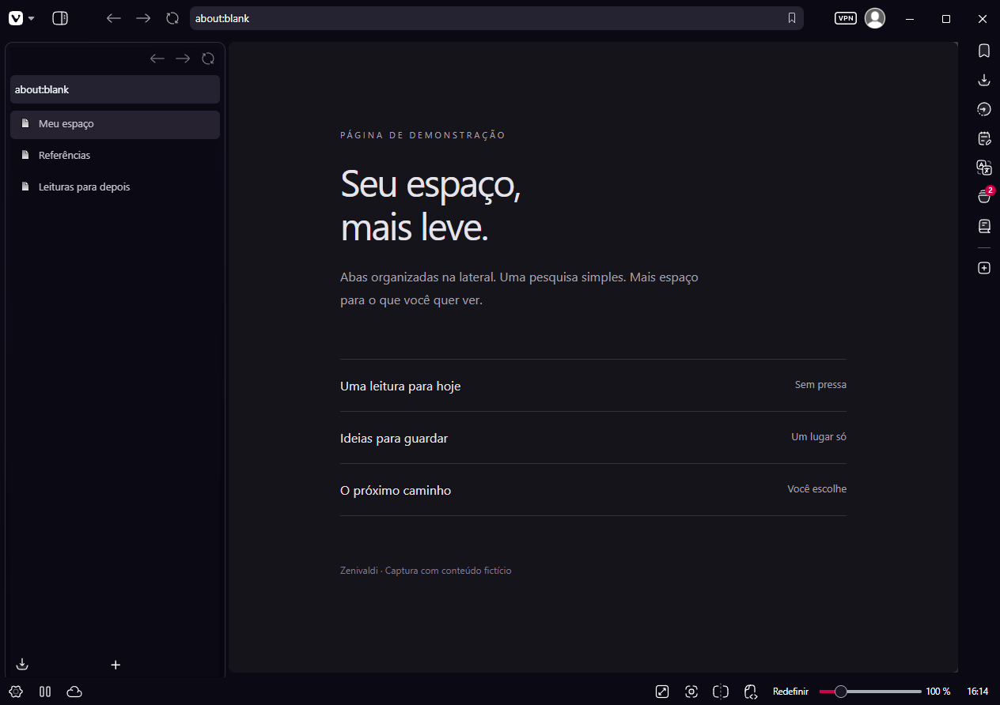
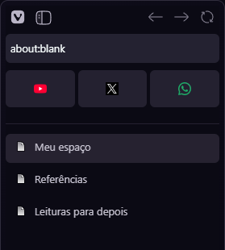
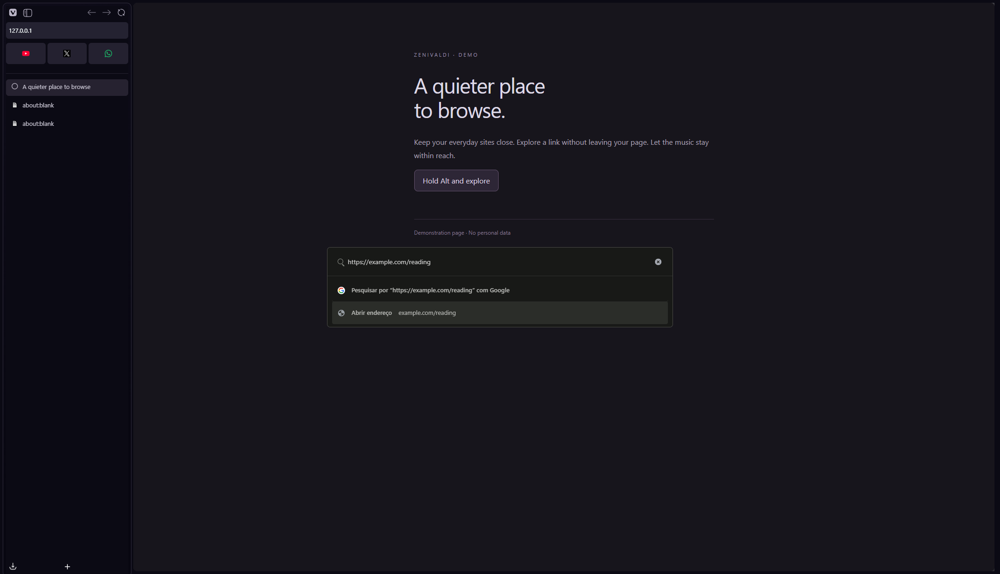
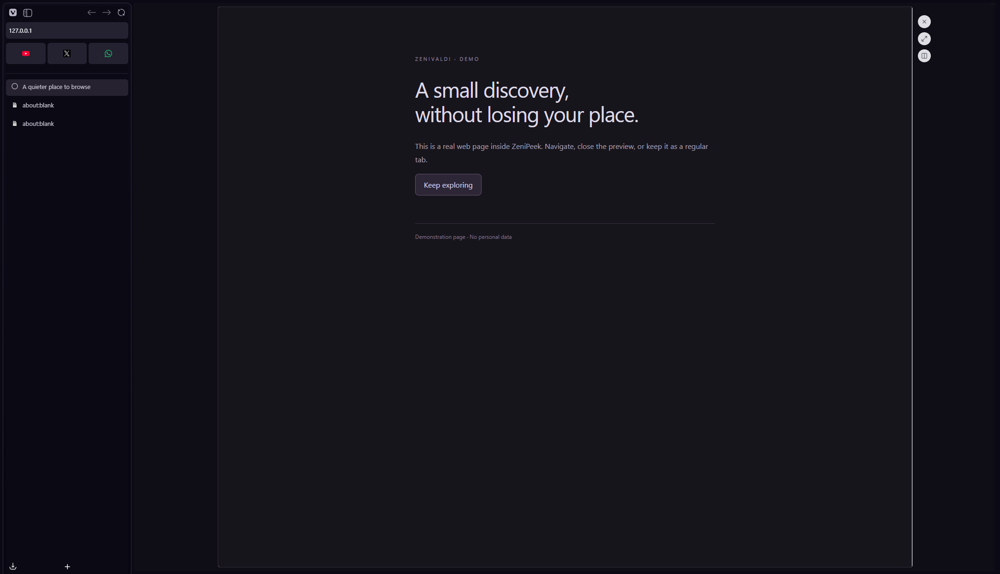
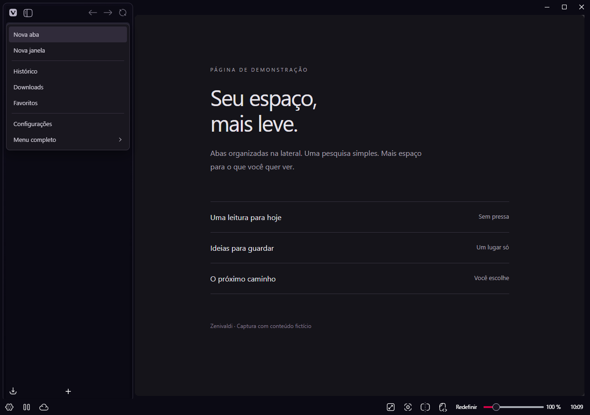

<h1>Zenivaldi</h1>

A calmer Vivaldi, inspired by Zen Browser.

Pinned sites. Floating search. Page previews. Playback within reach.

<a href="docs/README.pt-BR.md">Português brasileiro</a>
 · <a href="#install-on-windows">Install</a>
 · <a href="#search-without-friction">Search</a>
 · <a href="CONTRIBUTING.md">Contribute</a>

**Development preview:** the current source includes automatic layout setup and ZeniPeek. These changes
are not in the latest packaged release yet. The [latest published download](https://github.com/levigarciia/Zenivaldi/releases/latest)
is the stable version and does not include all the features shown here.

<em>Real Vivaldi captures in presentation mode, with fictional content and no personal data.</em>

| Keep sites close | Search without friction | Explore without losing your place |
| :--- | :--- | :--- |
| Pinned tabs become compact cards with site icons. | Open tabs, history, direct links and Google in one modal. | ZeniPeek previews a page while your original tab stays open. |

## Your everyday sites, pinned

Keep YouTube, WhatsApp, GitHub or any site you use daily at the top of the sidebar. Pinned tabs appear as small cards,
separate from regular tabs, without a long list of titles taking up space.

Right click a tab and choose **Pin Tab**. Use **Unpin Tab** to undo it, or drag pinned tabs to change their order.
These are Vivaldi's own pinned tabs, styled by Zenivaldi.

## Search without friction

Press **Ctrl+T** or **F2** to find your next destination without leaving the keyboard.

* **Go to the site:** suggestions prioritize home pages and simpler paths, with fewer repeated addresses.
* **Paste and open:** links and domains are ready to open with Enter, even if you have never visited them.
* **Google stays available:** the search option remains at the top, even when there are matching sites.
* **Pick up where you left off:** with no text, the modal shows the current window's open tabs.
* **Keep moving:** choose with the arrow keys and open with Enter. The modal closes when you confirm a destination.

You can enter a full URL or a domain such as `example.com/reading`. Selecting an open tab activates it rather than
opening another copy.

## ZeniPeek

Hold **Alt** while clicking a link to open a large interactive preview over your current page. The three round buttons
on its right close the preview, open its current address as a regular tab, or tile it beside your original page.

This is a live browser page, not a screenshot. Close it with Escape, the close button or a click outside the preview.
The temporary preview tab is removed when you close it. Your original tab remains available.

One preview is shown per window. The current implementation handles ordinary HTTP and HTTPS links; internal browser
pages are not injected. Opening a preview as a regular tab loads its current URL as a normal page.

## A menu that fits the sidebar

The Vivaldi button opens a compact menu for new tabs, windows, history, downloads, bookmarks and settings. It stays within
the sidebar rather than spreading submenus over the site. Use the arrows to navigate and Escape to close it.

Choose **Full menu** for Vivaldi's native advanced options.

## Scrolling that stays out of the way

The installer enables Chromium's native overlay scrollbars, smooth scrolling and Vivaldi's simple scrollbars. The page
does not need a reserved scrollbar strip. Site defined scrollbar styles continue to be respected.

The sidebar opens with a softer transition. Closing a tab animates its exit, including the last tab in the list; tabs
below a removed tab also move into place. Reduced motion preferences are respected.

## Install on Windows

You need Windows 10 or 11 and Vivaldi installed for your user in the default location. Open Vivaldi once before installing,
then close all its windows. No Bun, Node.js, Git or programming knowledge is required.

1. Download or obtain the Zenivaldi package you want to install.
2. Right click the ZIP and choose **Extract All**. Do not run the installer from inside the ZIP.
3. Close Vivaldi and double click **Instalar.cmd** in the extracted folder.
4. Wait for the success message, then open Vivaldi again.

The installer configures the left sidebar, an initial width of 265 pixels, automatic hiding, sidebar navigation and the
address field. It assigns **Ctrl+T** to floating search and keeps **F2** available. There is no toolbar dragging or manual
shortcut editing to do. Backups are created before changes, and unrelated shortcuts are preserved.
The extensions button uses Vivaldi's native dropdown, keeping installed extensions accessible from the sidebar.

The native interface has been checked with **Vivaldi 8.2.4133.96**. Browser updates may change internal UI contracts.

## Updates

The installer registers a Windows task for the current user. It checks stable releases from this repository every hour
while you are signed in. Updates are applied only when Vivaldi is closed, after verifying the ZIP's SHA256 digest.

If a browser update removes the UI scripts, the updater can repair them from its local cache, including while offline.
The development build is kept separate from the stable version; developers should use the installation option described
in [CONTRIBUTING.md](CONTRIBUTING.md).

* **Atualizar.cmd:** check now, with Vivaldi closed.
* **DesativarAtualizacoes.cmd:** disable updates while keeping the mod installed.
* **Instalar.cmd:** install, reapply or enable automatic updates again.

Existing users need to run an installer with update support once. The task does not keep a Zenivaldi program running
continuously. If Windows refuses task registration, the installer reports it and manual reapplication remains available.

## Remove

Close Vivaldi and double click **Remover.cmd**. The installer disables its scripts, removes the update task and restores
the saved layout, affected shortcuts, CSS directory and scrolling preferences. Unrelated shortcuts stay as they are.
Backups are kept.

The sidebar script also changes Vivaldi's internal animation timing values. Those timings can remain after removal and
can be adjusted in Vivaldi settings.

## Files and privacy

| Location | Contents |
| :--- | :--- |
| `%LOCALAPPDATA%\Vivaldi\Zenivaldi` | Installed styles and restoration state. |
| `%LOCALAPPDATA%\Vivaldi\ZenivaldiBackups` | Local backups. Do not publish them. |
| `%LOCALAPPDATA%\Vivaldi\ZenivaldiAtualizador` | Updater, cached packages and the latest result. |

The installer changes UI loading, layout, shortcuts and scrolling options. It does not import or delete passwords,
bookmarks or history. ZeniPeek uses page scripts to detect links and communicate with the local
browser UI. No Zenivaldi server receives page contents. Pages still make their normal
network requests; choosing Google search sends that query to Google.

If you already use another CSS mod directory, Zenivaldi becomes the active directory and saves the previous value for
removal. Combining independent mods has not been validated.

## Need help?

* **Vivaldi is still open:** close every window and check Task Manager for background processes.
* **Installation not found:** portable installations, protected folders and additional profiles need explicit paths.
  See [CONTRIBUTING.md](CONTRIBUTING.md).
* **The interface changed after an update:** close Vivaldi and run **Atualizar.cmd** or **Instalar.cmd** again.
* **An animation is missing:** check the operating system's reduced motion preference.
* **Still stuck?** [Open an issue](https://github.com/levigarciia/Zenivaldi/issues/new) with your Vivaldi and Windows versions
  and a screenshot without personal information.

## Contribute and credits

See [CONTRIBUTING.md](CONTRIBUTING.md) for development and native validation steps.

ZeniPeek is a focused adaptation of the concepts and Vivaldi integration techniques in
[Awesome Vivaldi](https://github.com/PaRr0tBoY/Awesome-Vivaldi). Credits are preserved in
[THIRD_PARTY_NOTICES.md](THIRD_PARTY_NOTICES.md), with the GPL version 3 license in [LICENSE](LICENSE).

Zenivaldi is an independent project. It is not an official product of Vivaldi or Zen Browser.
