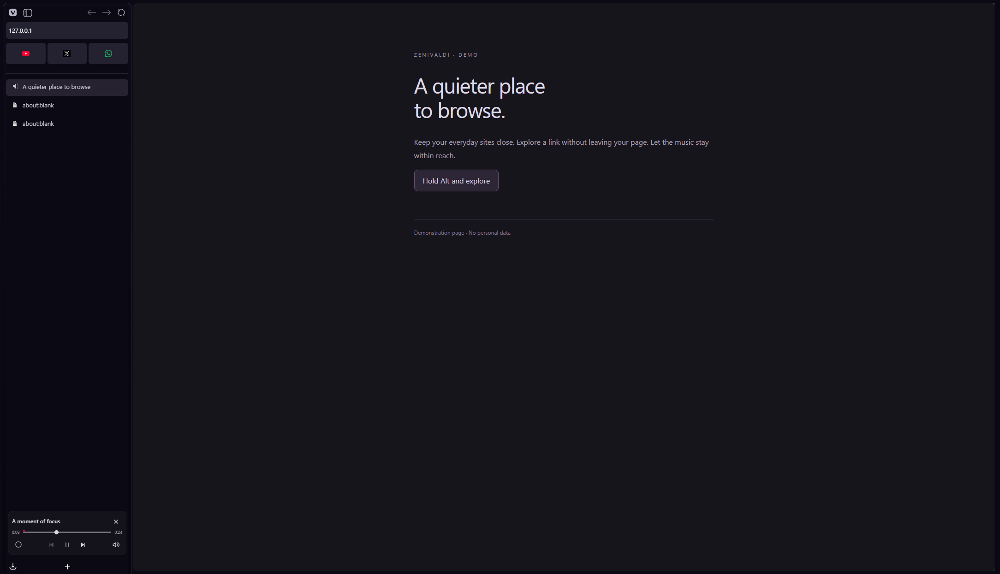
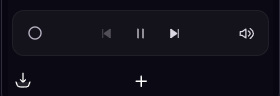

<h1>Zenivaldi</h1>

[English](../README.md)

**Prévia de desenvolvimento:** o código atual inclui ZeniPeek, ZeniPlayer e a instalação automática completa.
Essas mudanças ainda não estão no pacote da última versão publicada.

Seu Vivaldi com mais espaço e um visual inspirado no Zen Browser.

Seus sites favoritos fixados. Abas na lateral. Pesquisa flutuante.

<a href="https://github.com/levigarciia/Zenivaldi/releases/latest"><strong>Baixar para Windows</strong></a>
 · <a href="#como-instalar">Como instalar</a>
 · <a href="#como-remover">Como remover</a>
 · <a href="https://github.com/levigarciia/Zenivaldi/issues">Relatar um problema</a>

<em>Captura real do Vivaldi em perfil de demonstração, com página e dados fictícios.</em>

| Seus sites sempre à mão | Pesquisa mais clara | Instalação simples |
| :--- | :--- | :--- |
| Abas fixadas em pequenos cartões com ícones, acima das outras abas. | Endereços simples primeiro e Google sempre disponível. | Baixe, extraia e execute. Sem ferramentas de programação. |

## Seus favoritos viram abas fixadas

YouTube, WhatsApp, GitHub ou qualquer site que você usa todo dia: fixe a aba e deixe seu ícone no topo da lateral. Os sites fixados ficam em pequenos cartões, separados das abas comuns, sem uma lista de títulos ocupando espaço.

**Para fixar:** abra o site, clique com o botão direito na aba e escolha **Fixar aba**. Para desfazer, use **Desafixar aba** no mesmo menu. Você também pode arrastar as abas fixadas para mudar a ordem.

Essa função usa as abas fixadas do próprio Vivaldi. O Zenivaldi cuida do visual, sem criar atalhos extras nem depender de uma conta do mod.

## Pesquise sem atrito

Abra o modal com **F2** e encontre seu próximo destino sem sair do teclado. Alterne entre as abas abertas, encontre sites no histórico, cole um link ou faça uma pesquisa no Google, tudo no mesmo lugar.

* **Encontre o site, não uma lista de posts:** as sugestões priorizam a página principal e os caminhos mais simples, sem repetir endereços que só mudam no fragmento.
* **Cole e abra:** links e domínios ficam prontos para abrir com Enter, mesmo que você nunca tenha visitado o site.
* **Google sempre à mão:** a opção de pesquisar fica fixa no topo, inclusive quando há sugestões de sites.
* **Continue de onde parou:** sem texto, o modal mostra as abas da janela atual. Escolher uma delas ativa a aba existente.
* **Tudo pelo teclado:** use as setas para escolher e Enter para abrir. O modal fecha ao confirmar o destino e mantém o mesmo visual ao ser aberto novamente.

Na captura, o link colado já está selecionado em **Abrir endereço**, com o Google disponível como alternativa. Também funciona com domínios sem `https://`, como `exemplo.com/leituras`.

## Um menu que cabe na lateral

O botão do Vivaldi abre um menu compacto, alinhado à barra de abas, sem espalhar submenus por cima do site. Nova aba, nova janela, histórico, downloads, favoritos e configurações ficam à mão. Use as setas para escolher uma opção e Escape para fechar.

Para acessar as opções avançadas do navegador, escolha **Menu completo**. Essa opção abre o menu nativo do Vivaldi.

## Rolagem que sai do caminho

O instalador ativa as barras de rolagem nativas sobrepostas do Chromium: sem uma faixa reservada na página e ocultas quando não estão em uso. Também habilita a rolagem suave e as barras simples do Vivaldi.

Essas configurações entram em vigor quando você abre o navegador depois da instalação. Os estilos de rolagem definidos pelos próprios sites continuam sendo respeitados. Ao remover o mod, as configurações anteriores de rolagem são restauradas.

## Instale sem programar

Use **Instalar.cmd** para instalar ou reaplicar e **Remover.cmd** para desativar. As atualizações automáticas são ativadas na instalação. Você não precisa mexer nos arquivos de código.

## O que muda

* Abas verticais com ícones alinhados, animação de saída inclusive na última aba da lista e deslocamento suave das demais.
* Abas fixadas em cartões compactos no topo, com os ícones dos seus sites.
* Menu e botão de mostrar ou ocultar o painel junto de voltar, avançar e recarregar na lateral.
* Menu compacto para as opções do dia a dia, com acesso ao menu completo do Vivaldi.
* Barra superior duplicada oculta quando o campo de endereço já está na lateral. Os controles da janela continuam disponíveis.
* Pesquisa flutuante com o mesmo visual ao abrir e durante a digitação.
* Sugestões que priorizam a página principal dos sites e reduzem endereços repetidos.
* Opção de pesquisar no Google sempre visível no topo da lista.
* Lista sem barra de rolagem visível. A roda do mouse e as setas continuam funcionando.
* Fechamento do modal ao abrir um resultado com clique ou Enter.
* Ajuste de posição dos popups para evitar que fiquem cortados pela janela.
* Abertura mais suave da lateral, respeitando campos de texto, popups e a preferência por reduzir movimentos.
* No modo de ocultação automática, as abas aparecem sobre o site sem deslocar seu conteúdo para baixo.
* Atualizações automáticas e restauração dos scripts após atualizações do Vivaldi, quando o navegador estiver fechado.
* Barras de rolagem sobrepostas e rolagem suave habilitadas por padrão.

O Zenivaldi modifica a interface do Vivaldi. Ele não instala o Zen Browser e não troca o mecanismo que abre os sites.

## Antes de instalar

* Windows 10 ou 11 com Vivaldi instalado para o seu usuário, no local padrão.
* Abra o Vivaldi pelo menos uma vez antes de instalar.
* Feche todas as janelas do Vivaldi. O instalador avisa se ele ainda estiver aberto.

A interface foi validada no Vivaldi **8.2.4133.96**. Como o mod depende de partes internas do navegador, outras versões podem precisar de ajustes.

O instalador não precisa de Bun, Node.js, Git ou editor de código. Ele usa o PowerShell que já vem no Windows.

## Como instalar

1. Abra a [página de downloads](https://github.com/levigarciia/Zenivaldi/releases/latest).
2. Em **Assets**, baixe **Zenivaldi.zip**.
3. Clique com o botão direito no arquivo baixado e escolha **Extrair Tudo**.
4. Abra a pasta extraída. Não execute o instalador de dentro do ZIP.
5. Feche o Vivaldi e dê dois cliques em **Instalar.cmd**.
6. Aguarde a mensagem de instalação concluída e abra o Vivaldi novamente.

Pronto. O instalador ativa o carregamento do CSS e dos scripts, cria um backup antes das alterações e registra a verificação automática para seu usuário do Windows.

Se o Windows mostrar uma confirmação para executar o arquivo, confira se ele veio deste repositório. Não é necessário desativar o antivírus nem mudar configurações permanentes de segurança.

## Tudo pronto ao instalar

O instalador configura as abas à esquerda, largura inicial de 265 pixels, ocultação automática, endereço e navegação na lateral e o atalho **Ctrl+T** para abrir a pesquisa. **F2** continua disponível. Não é necessário arrastar controles nem editar atalhos manualmente.

O botão de extensões usa a lista suspensa nativa do Vivaldi, mantendo as extensões instaladas acessíveis pela lateral.

As preferências alteradas e os atalhos envolvidos são guardados para a remoção. Os demais atalhos continuam como estavam.

## ZeniPeek

Use **Alt+clique** em um link para abrir uma prévia grande e interativa sobre a página atual. Os três botões circulares à direita permitem fechar, abrir o endereço atual em uma aba normal ou dividir a tela com a página de origem. Você também pode fechar com Escape ou clicando fora.

A prévia usa uma página real do navegador, não uma imagem. Há uma prévia por janela. Ao fechar, sua aba temporária é removida e a aba de origem continua disponível.

## ZeniPlayer

Quando um site reproduz áudio ou vídeo compatível, o ZeniPlayer aparece recolhido no rodapé da lateral, com o ícone do site e os controles de reprodução. Passe o mouse ou use o teclado para revelar título, progresso e ações adicionais. Controle pausa, reprodução, posição, volume e mudo sem trocar de aba.

Você pode escolher entre fontes de mídia abertas. Os controles de faixa aparecem quando o site fornece essas ações. PiP depende de suporte do vídeo, do navegador e das permissões de reprodução. Ocultar os controles não interrompe o áudio. Enquanto houver um vídeo em PiP, o player da lateral fica oculto e retorna quando a janela flutuante fecha.

## Como usar a pesquisa

* Sem texto: mostra as abas da janela atual. Escolher uma delas ativa a aba existente.
* Com texto: busca no histórico local e prioriza endereços mais simples.
* **Pesquisar com Google**: fica fixo no topo, mesmo quando há sugestões de sites.
* Ao colar um link ou digitar um domínio, **Abrir endereço** aparece e começa selecionado. Enter abre o link diretamente, mesmo que ele nunca tenha sido visitado. A pesquisa no Google continua disponível.
* **Setas**: mudam a opção selecionada. **Enter**: abre a seleção. Você também pode clicar.
* Havendo sugestões de sites, a primeira delas começa selecionada. Para pesquisar no Google, clique na primeira linha ou use a seta para cima até selecioná la.

A opção do Google usa explicitamente o Google, mesmo que outro buscador esteja configurado no navegador. As sugestões vêm do histórico local. Não há um servidor do Zenivaldi recebendo o que você digita; a pesquisa escolhida é enviada ao Google quando você a abre.

## Atualizações sem baixar tudo de novo

A partir da versão **0.1.3**, o instalador ativa uma tarefa do Windows que verifica atualizações **a cada hora**, enquanto seu usuário está conectado. Não é necessário manter a pasta baixada aberta, nem deixar um programa do Zenivaldi rodando continuamente.

* Busca a versão estável mais recente nas releases deste repositório.
* Confere o SHA256 do ZIP informado pelo GitHub antes de usar o pacote.
* Só aplica mudanças com o Vivaldi fechado. Se ele estiver aberto, tenta de novo na próxima verificação, sem encerrar suas abas.
* Se uma atualização do Vivaldi remover os scripts, reaplica a cópia local do mod, inclusive sem internet.
* Mantém backups das preferências e dos arquivos de carregamento antes da instalação.

**Já usava uma versão anterior?** Baixe a versão atual e execute **Instalar.cmd** uma vez, com o Vivaldi fechado. As versões antigas não tinham um atualizador capaz de ativar esse recurso sozinhas.

**Quer verificar agora?** Feche o Vivaldi e execute **Atualizar.cmd**. Para desativar apenas as atualizações, use **DesativarAtualizacoes.cmd**. O mod continua instalado. Execute **Instalar.cmd** novamente para reativar.

O resultado da última tentativa fica em `%LOCALAPPDATA%\Vivaldi\ZenivaldiAtualizador\ultimo-resultado.txt`. Se o Windows impedir o agendamento, o instalador avisa; nesse caso, você ainda pode reaplicar o mod manualmente. Instalações em pastas protegidas podem não permitir atualizações com as permissões normais do usuário.

## Atualizou o Vivaldi e o visual sumiu?

Isso pode acontecer porque uma atualização substitui os arquivos que carregam os scripts. O CSS pode continuar aparecendo enquanto a lista de pesquisa volta ao visual original. Com a atualização automática ativada, feche o navegador e aguarde a próxima verificação ou execute **Atualizar.cmd**. Para reaplicar manualmente:

1. Feche o Vivaldi.
2. Abra a pasta do Zenivaldi e execute **Instalar.cmd** novamente.
3. Abra o navegador.

Não é preciso desinstalar antes. Se uma versão nova continuar com problema, veja se há uma [versão atualizada do mod](https://github.com/levigarciia/Zenivaldi/releases).

## Como remover

Feche o Vivaldi e dê dois cliques em **Remover.cmd** na pasta extraída.

Isso desativa os scripts deste instalador e restaura a configuração anterior de carregamento do CSS. Os backups são mantidos. O layout e os atalhos envolvidos voltam aos valores guardados na instalação. Atalhos não relacionados continuam como estavam.

A tarefa de atualização também é desativada, para que o mod não volte a ser instalado depois da remoção.

O script de recolhimento ajusta os tempos internos de animação da barra. Esses valores podem permanecer após a remoção, e podem ser ajustados nas configurações do Vivaldi.

## Onde os arquivos ficam

* Mod instalado: `%LOCALAPPDATA%\Vivaldi\Zenivaldi`.
* Backups: `%LOCALAPPDATA%\Vivaldi\ZenivaldiBackups`.
* Scripts carregados: pasta `user_files\zenivaldi` dentro dos recursos da versão instalada do Vivaldi.
* Atualizador e pacotes locais: `%LOCALAPPDATA%\Vivaldi\ZenivaldiAtualizador`.

O instalador altera o documento da interface, a pasta de CSS e as opções de CSS personalizado e rolagem. Ele não importa nem apaga suas senhas, favoritos ou histórico. Os backups de preferências são locais e podem conter configurações pessoais. Não publique essa pasta.

Se você já usa outro mod de CSS, o Zenivaldi passa a ser a pasta de CSS ativa. A configuração anterior é guardada para a remoção. A combinação com outros mods não foi validada.

## Problemas comuns

**O instalador diz que o Vivaldi está aberto:** feche todas as janelas. Se continuar, verifique no Gerenciador de Tarefas se há processos do Vivaldi em segundo plano.

**O Vivaldi não foi encontrado:** a instalação por dois cliques atende à pasta padrão do usuário. Instalações portáteis, para todos os usuários e perfis adicionais exigem informar os caminhos manualmente. Consulte o [guia de contribuição](CONTRIBUTING.pt-BR.md).

**A animação não aparece:** o mod respeita a preferência do Windows por reduzir movimentos. A animação de fechamento se aplica ao deslocamento das abas não fixadas na lateral esquerda.

**Algo ficou fora do lugar:** confirme a posição das abas à esquerda, reaplique o instalador após uma atualização e confira a versão validada acima.

**Ainda não funcionou:** [abra um relato de problema](https://github.com/levigarciia/Zenivaldi/issues/new) com a versão do Vivaldi, sua versão do Windows e uma imagem sem dados pessoais.

## Contribuir

Consulte o [guia de contribuição](CONTRIBUTING.pt-BR.md).

## Créditos

ZeniPeek e ZeniPlayer usam como referência o [Awesome Vivaldi](https://github.com/PaRr0tBoY/Awesome-Vivaldi).
Os créditos estão em [THIRD_PARTY_NOTICES.md](../THIRD_PARTY_NOTICES.md), com licença GPL versão 3 em [LICENSE](../LICENSE).

Projeto independente, inspirado no Zen Browser e feito para o Vivaldi. Não é um produto oficial de nenhum dos dois navegadores.
